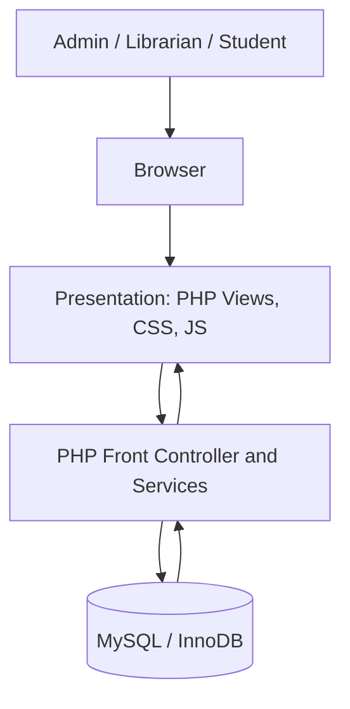
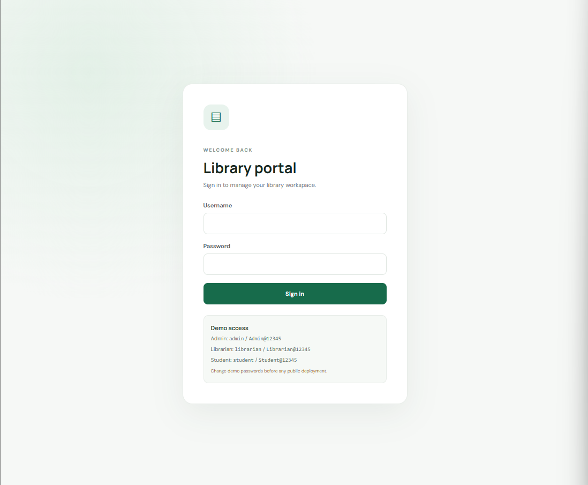
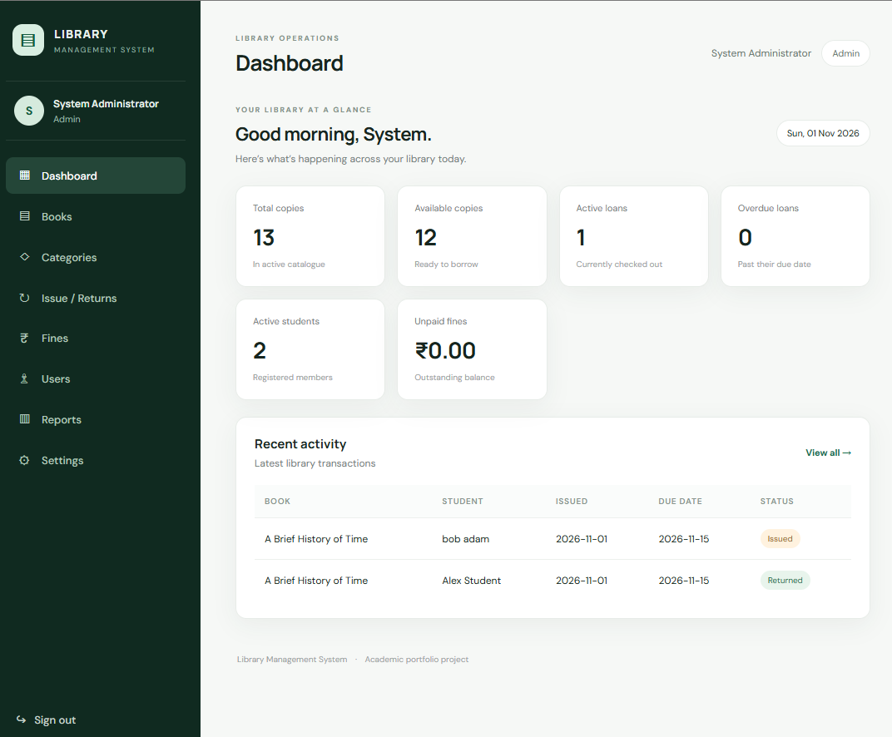
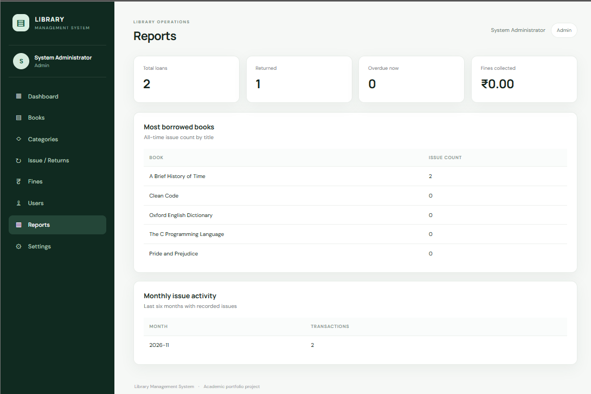
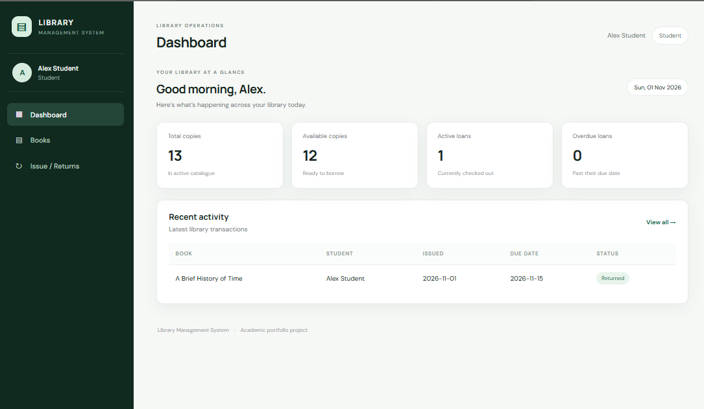

# 📚 Library Management System

<p align="center">
  <strong>A PHP & MySQL Based Library Management Web Application</strong>
  <br>
  A simple, structured and role-based system for managing books, members, borrowing and returns.
</p>

<p align="center">
  
  
  
  
  
  
</p>

---


A role-based library web application built with **PHP 8.2+, MySQL 8, HTML5, CSS3 and JavaScript**. It supports catalogue management, member accounts, book issuing and returns, overdue fines, transaction history and reports.


> **Implementation status:** This repository contains a runnable initial implementation of the core modules. Payment gateway, notifications, reservations, RFID/barcode hardware, multi-branch support and mobile apps are not implemented. Review the test plan and run the MySQL integration checks locally before production use.

## Contents
- [Overview](#overview)
- [Roles and features](#roles-and-features)
- [Technology and requirements](#technology-and-requirements)
- [Architecture](#architecture)
- [Database design](#database-design)
- [Installation](#installation)
- [Demo accounts](#demo-accounts)
- [Workflows and policies](#workflows-and-policies)
- [Security](#security)
- [Testing](#testing)
- [Deployment](#deployment)
- [GitHub workflow](#github-workflow)
- [Limitations and roadmap](#limitations-and-roadmap)
- [Contribution](#contribution)
- [License](#license)

## Overview

The system replaces paper-based catalogue and circulation records with a central application. It provides role-specific navigation and stores account, catalogue and loan information in a relational database.

## Roles and features

| Role | Capabilities |
|---|---|
| Administrator | Dashboard, create users, add/archive books, categories, configure policies, reports, fine register |
| Librarian | Dashboard, catalogue, categories, issue/return, overdue visibility, fine register and reports |
| Student | Dashboard, catalogue search, personal loan history |

### Modules
- Authentication and session handling.
- Book and category catalogue.
- Student/librarian/admin account creation.
- Issue and return processing with transactional inventory updates.
- Configurable borrowing limit, loan duration and fine rate.
- Overdue and unpaid-fine views.
- Summary reports and recent activity.

## Technology and requirements

| Component | Requirement |
|---|---|
| PHP | 8.2 or later; PDO and PDO_MYSQL extensions |
| Database | MySQL 8.0+ / MariaDB compatible InnoDB release |
| Web server | Apache (XAMPP recommended for local setup) |
| Browser | Current Chrome, Firefox, Edge or Safari |
| Tools | Git, VS Code or equivalent, phpMyAdmin optional |

## Architecture

Three tiers: browser presentation (`views/`, `public/assets/`), PHP application (`app/core/`, `app/services/`) and MySQL data (`database/`). The public document root is `public/`. Database access is centralized through PDO. See [`docs/ARCHITECTURE.md`](docs/ARCHITECTURE.md), [`docs/SRS.md`](docs/SRS.md) and [`docs/DATABASE.md`](docs/DATABASE.md).



## Database design

Database: `library_management`.

| Table | Purpose |
|---|---|
| users | Authentication, role and account state |
| students | Student profile |
| librarians | Librarian profile |
| categories | Catalogue classification |
| books | Book metadata and copy counts |
| book_transactions | Issue/return records |
| fines | Fine amount and payment state |
| system_settings | Loan/fine policies |

The schema uses primary/foreign keys, unique constraints, indexes and InnoDB. Inventory updates are performed in transactions with row-level locks. Full SQL is in `database/schema.sql` and demo data in `database/seed.sql`.

## Installation

### 1. Install prerequisites

Install XAMPP with PHP 8.2+ and MySQL/MariaDB, or configure Apache/PHP/MySQL separately. Ensure `pdo_mysql` is enabled.

### 2. Place the project

Clone into the XAMPP web root:

```bash
cd C:\xampp\htdocs
git clone https://github.com/areeb-00/Library-Management-System.git
cd Library-Management-System
```

Or copy the project folder into `C:\xampp\htdocs\Library-Management-System`.

### 3. Create database and import SQL

Start Apache and MySQL in XAMPP. In phpMyAdmin, import `database/schema.sql`, then import `database/seed.sql`. Alternatively, run:

```bash
mysql -u root -p < database/schema.sql
mysql -u root -p library_management < database/seed.sql
```

The schema script creates the database. Do not run the schema reset against a database containing data you need: it drops and recreates project tables.

### 4. Configure environment

Copy `.env.example` to `.env`, then set your local database details:

```env
APP_ENV=development
APP_DEBUG=true
DB_HOST=127.0.0.1
DB_PORT=3306
DB_NAME=library_management
DB_USERNAME=root
DB_PASSWORD=your_local_password
```

The small environment loader is included in `app/bootstrap.php`; no Composer package is required. Never commit `.env` or use the demo credentials on a public server.

### 5. Open the application

For XAMPP, open:

`http://localhost/Library-Management-System/public/`

For the PHP development server, from the project root run:

```bash
php -S 127.0.0.1:8000 -t public
```

Then open `http://127.0.0.1:8000`.

## Demo accounts

| Role | Username | Password |
|---|---|---|
| Administrator | `admin` | `Admin@12345` |
| Librarian | `librarian` | `Librarian@12345` |
| Student | `student` | `Student@12345` |

These accounts are for local evaluation only. Change passwords and remove demo users before deployment. Seed data uses PHP password hashes.

## Workflows and policies

### Issue
Librarian selects an active student and available book. The service checks the member's active status, concurrent-loan limit and inventory under transaction locks, creates the loan and decrements available copies.

### Return
Librarian selects an active loan. The service marks it returned, records the date, restores one available copy and creates a fine if overdue. All changes are committed atomically.

### Default business rules
- Maximum 3 active loans per student.
- Default loan period 14 days.
- Fine rate ₹2 per overdue day.
- Due date is not chargeable; days are counted from the following day.
- Active loans cannot be deleted. Books with active loans cannot be archived.

Administrators can change the first three policies in Settings.

## Security

- `password_hash()` / `password_verify()` for password storage and verification.
- Session ID regenerated after successful login; HTTP-only and SameSite=Lax session cookies.
- PDO prepared statements; emulated prepares disabled.
- CSRF token on state-changing forms.
- Server-side role checks for protected routes/actions.
- HTML output escaped with `htmlspecialchars()`.
- Errors logged; generic message shown when debug is disabled.
- `.env` excluded from Git; production should use HTTPS, least-privilege DB credentials, backups and `APP_DEBUG=false`.

This is an academic baseline, not a security-certified product. Perform a full security review before handling real personal data.

## Testing

Run syntax checks:

```bash
find app public views tests -name '*.php' -print0 | xargs -0 -n1 php -l
php tests/smoke_test.php
```

See [`docs/TESTING.md`](docs/TESTING.md) for the manual integration matrix. The smoke checks do not exercise a live MySQL connection; complete the issue/return, authorization, CSRF and fine test cases against your local database and record actual outcomes.

## Deployment

1. Provision supported PHP and MySQL versions.
2. Create a dedicated database and restricted database user.
3. Configure secrets outside the public web root.
4. Deploy the project and set the web document root to `public/`.
5. Import schema and required production data; remove demo accounts.
6. Set `APP_ENV=production` and `APP_DEBUG=false`.
7. Enable HTTPS and secure cookies; configure backups and log rotation.
8. Run the integration test matrix and verify recovery from a backup.

Do not expose the project root, `.env`, SQL backups or logs through the web server.

## GitHub workflow

```bash
git init
git add .
git commit -m "feat: initial library management system"
git branch -M main
git remote add origin https://github.com/areeb-00/Library-Management-System.git
git push -u origin main
```

Suggested commit prefixes: `feat:`, `fix:`, `test:`, `docs:`, `refactor:`. Review staged files before every push and ensure `.env` is not included.

## Limitations and roadmap

Not included in this initial version: self-service registration, book reservations/waitlists, email/SMS reminders, online payments, barcode/RFID, PDF export, audit-log viewer, multi-branch sync, mobile app and university ERP integration. Useful next improvements: account activation/deactivation UI, pagination, downloadable CSV/PDF reports, password reset, automated integration tests and audit logging.

## Contribution

1. Fork the repository.
2. Create a focused branch (`git checkout -b feature/name`).
3. Follow existing PHP style and security practices.
4. Add tests and update documentation.
5. Run syntax and smoke checks.
6. Open a pull request describing changes and test results.

## License

MIT License. See [`LICENSE`](LICENSE).

## Academic context

BCA – 5th Semester | Subject: Software Quality Testing | Stack: PHP, MySQL, HTML5, CSS3 and JavaScript.

## Application Screenshots

### 1. Login Page


### 2. Admin Dashboard


### 3. Reports


### 4. Student Dashboard
