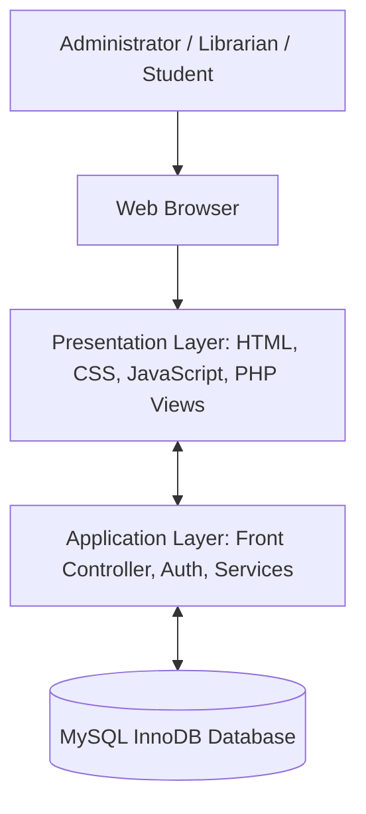
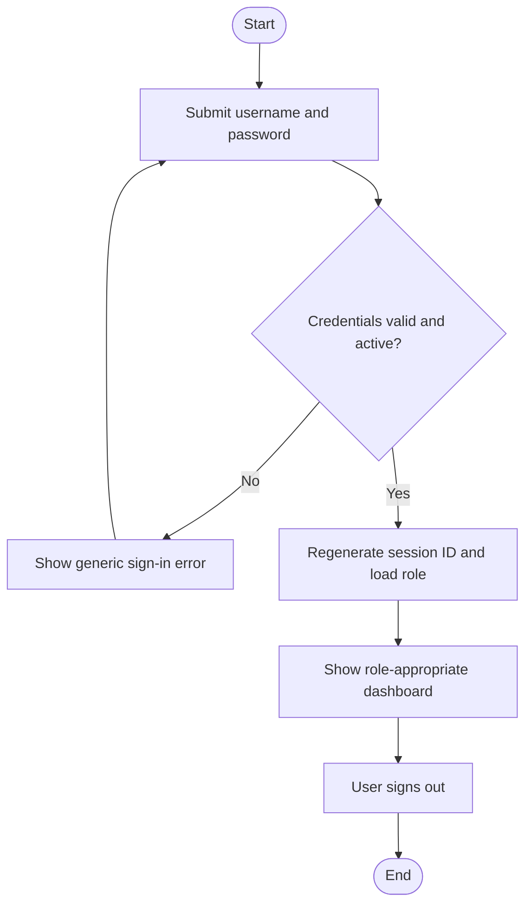
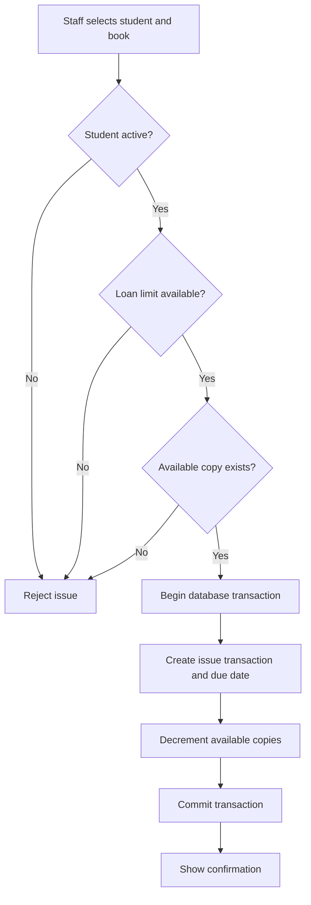
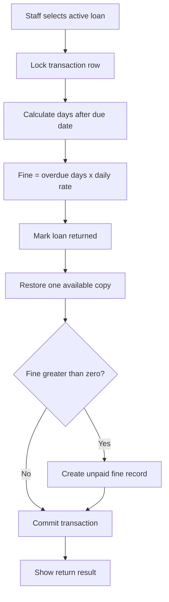
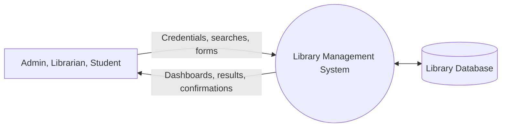

# System Design and Workflows

## 1. System architecture

## 2. Authentication and navigation flow

## 3. Use-case matrix

| Use case | Administrator | Librarian | Student |
|---|---:|---:|---:|
| Sign in / sign out | Yes | Yes | Yes |
| Search catalogue | Yes | Yes | Yes |
| Add / edit books | Yes | Yes | No |
| Archive books | Yes | No | No |
| Manage categories | Yes | Yes | No |
| Create user accounts | Yes | No | No |
| Issue / return books | Yes | Yes | No |
| View own loan history | No | No | Yes |
| Manage fine payment state | Yes | Yes | No |
| View reports | Yes | Yes | No |
| Configure library policy | Yes | No | No |

## 4. Issue workflow

## 5. Return and fine workflow

## 6. Data flow diagram — context / level 0

## 7. Core business rules

- Only active students may borrow books.
- Only staff roles may issue or return books.
- A student may hold no more than the configured number of active loans.
- A book must have at least one available copy before issue.
- Issue and return operations update the loan and inventory in one transaction.
- Fine days begin the day after the due date; due date itself is not charged.
- Historical transactions are retained; books are archived rather than hard-deleted.
